<!--
  Profile README for github.com/deshnaas
  Artwork lives in /assets and is generated by scripts/build_assets.py (static)
  and scripts/build_stats.py (analytics, refreshed daily by GitHub Actions).
-->


   
  
  
  
  

 

<!-- ─────────────────────────────── 01 · ACHIEVEMENTS ─────────────────────────────── -->

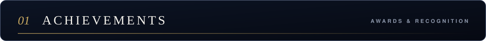

  
  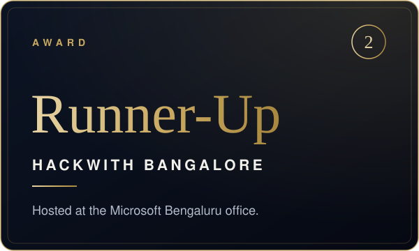

  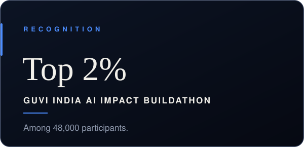
  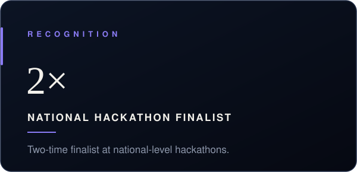

  
  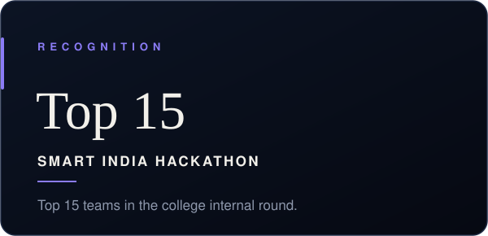

 

<!-- ─────────────────────────────── 02 · ABOUT ─────────────────────────────── -->

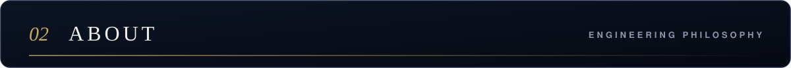

I'm an AI/ML engineering student who likes taking an idea the whole way: from identifying the problem, to a working prototype, to something a real person can use.

My work sits where **artificial intelligence, machine learning and intelligent automation** meet the physical world — **voice AI** that works over an ordinary phone line, **IoT and embedded systems**, and whichever emerging technology actually fits the problem.

**How I build**

- **Start with the real problem.** If the user doesn't own a smartphone, the answer isn't an app. It might be a phone call.
- **Ship the smallest system that works end to end.** A prototype that runs teaches more than a diagram that doesn't.
- **Use AI where it earns its place.** Safety-critical paths stay deterministic; models handle what they are good at.
- **Test against reality.** Real voices, real noise, real edge cases — then iterate.

 

<!-- ─────────────────────────────── 03 · FEATURED PROJECTS ─────────────────────────────── -->

<a href="https://github.com/deshnaas/voxera-ai"></a>

### Voxera &nbsp;·&nbsp; Flagship

A multilingual, voice-first AI rural healthcare and care-coordination platform that makes healthcare navigation accessible through an ordinary phone call — no smartphone required.

<table>
  <tr><td width="130"><b>Problem</b></td><td>Rural patients are locked out of digital health tools by apps, typing and literacy barriers. A voice call is the one interface everyone already has.</td></tr>
  <tr><td width="130"><b>What it does</b></td><td>Listens, detects the caller's language (Hindi, Marathi or English), triages symptoms, escalates emergencies, gives curated care guidance and records the call for hospital staff on a coordination dashboard.</td></tr>
  <tr><td width="130"><b>Engineering</b></td><td>Emergency detection is a deterministic, two-stage layer that runs before any LLM on every turn. The LLM may only re-word approved care text. A telephony channel bridges phone audio into the same call pipeline.</td></tr>
  <tr><td width="130"><b>Stack</b></td><td><code>Python</code> <code>Whisper</code> <code>Kokoro TTS</code> <code>Ollama</code> <code>FastAPI</code> <code>Supabase</code> <code>PostgreSQL</code> <code>Next.js</code> <code>TypeScript</code></td></tr>
  <tr><td width="130"><b>Links</b></td><td><a href="https://github.com/deshnaas/voxera-ai">Repository</a> &nbsp;·&nbsp; <a href="https://voxera-ai-three.vercel.app">Live dashboard</a></td></tr>
</table>

---

### AI-Generated Voice Detection

A multilingual AI system that tells human speech from AI-generated speech.

<table>
  <tr><td width="130"><b>Problem</b></td><td>Synthetic voices are now convincing enough to enable fraud and impersonation, and detection has to hold up across Indian languages, not just English.</td></tr>
  <tr><td width="130"><b>What it does</b></td><td>Converts audio into mel spectrograms and classifies them with a CNN, returning a verdict and confidence score through an authenticated REST API. Covers Tamil, English, Hindi, Malayalam and Telugu.</td></tr>
  <tr><td width="130"><b>Stack</b></td><td><code>Python</code> <code>TensorFlow / Keras</code> <code>Librosa</code> <code>NumPy</code> <code>FastAPI</code></td></tr>
  <tr><td width="130"><b>Links</b></td><td><a href="https://github.com/deshnaas/voice-ai-detection-api">Repository</a></td></tr>
</table>

---

### Sentinel

Reliability monitoring for edge computer-vision pipelines.

<table>
  <tr><td width="130"><b>Problem</b></td><td>A camera can stay online while its input quietly becomes untrustworthy — darkness, blur, obstruction or a shifted view — and the model downstream keeps answering anyway.</td></tr>
  <tr><td width="130"><b>What it does</b></td><td>Measures a live feed against a healthy baseline, raises evidence-backed incidents as JSON, and resolves them only once recovery has actually been observed. Currently a local CPU MVP.</td></tr>
  <tr><td width="130"><b>Stack</b></td><td><code>Python</code> <code>OpenCV</code> <code>NumPy</code> <code>FastAPI</code></td></tr>
  <tr><td width="130"><b>Links</b></td><td><a href="https://github.com/deshnaas/CraftifAIHackathon_CRA003">Repository</a></td></tr>
</table>

---

### PitchLens

One football match, three realities — for the new fan, the supporter and the referee.

<table>
  <tr><td width="130"><b>Problem</b></td><td>Broadcasts are built for one kind of viewer. A first-time fan, a die-hard supporter and a referee analyst need entirely different explanations of the same moment.</td></tr>
  <tr><td width="130"><b>What it does</b></td><td>Renders real StatsBomb 360 match data as a 3D stadium with a lens-specific AI coach, grounded in the FIFA Laws of the Game. Built for the IBM SkillsBuild challenge.</td></tr>
  <tr><td width="130"><b>Stack</b></td><td><code>Next.js</code> <code>TypeScript</code> <code>Three.js</code> <code>FastAPI</code> <code>IBM Docling</code> <code>Docker</code></td></tr>
  <tr><td width="130"><b>Links</b></td><td><a href="https://github.com/deshnaas/pitchlens2">Repository</a> &nbsp;·&nbsp; <a href="https://pitchlens2.vercel.app">Live demo</a></td></tr>
</table>

---

### Epikrisis AI

The AI backend for a healthcare interoperability platform.

<table>
  <tr><td width="130"><b>Problem</b></td><td>Clinicians have minutes, not hours, to absorb a patient record before a visit — and generic AI answers can't be trusted as patient fact.</td></tr>
  <tr><td width="130"><b>What it does</b></td><td>Four clinician tools — summary, insights, patient-scoped chat and a treatment-comparison "digital twin" — that reason only over the patient data supplied and refuse to diagnose or prescribe.</td></tr>
  <tr><td width="130"><b>Stack</b></td><td><code>JavaScript</code> <code>Node.js</code> <code>Express</code> <code>Gemini</code></td></tr>
  <tr><td width="130"><b>Links</b></td><td><a href="https://github.com/deshnaas/Epikrisis-AI-v1">Repository</a></td></tr>
</table>

 

<!-- ─────────────────────────────── 04 · TECHNICAL EXPERTISE ─────────────────────────────── -->

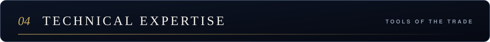

| Domain | Technologies |
|:--|:--|
| **Programming** | Python &nbsp;·&nbsp; C &nbsp;·&nbsp; JavaScript &nbsp;·&nbsp; TypeScript &nbsp;·&nbsp; SQL |
| **AI / ML** | TensorFlow &nbsp;·&nbsp; Scikit-learn &nbsp;·&nbsp; Pandas &nbsp;·&nbsp; NumPy &nbsp;·&nbsp; Speech & audio ML &nbsp;·&nbsp; Computer vision (OpenCV) &nbsp;·&nbsp; LLM integration |
| **Backend** | FastAPI &nbsp;·&nbsp; REST APIs |
| **Databases** | PostgreSQL &nbsp;·&nbsp; Supabase |
| **Tools** | Git &nbsp;·&nbsp; GitHub &nbsp;·&nbsp; Docker &nbsp;·&nbsp; VS Code |
| **IoT & Embedded Systems** | Embedded C &nbsp;·&nbsp; Edge computer-vision pipelines &nbsp;·&nbsp; MQTT |

 

<!-- ─────────────────────────────── 05 · GITHUB ANALYTICS ─────────────────────────────── -->



  
  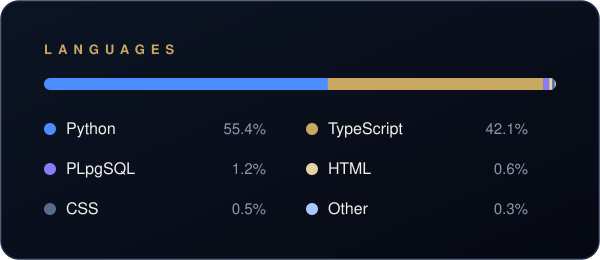

 

<!-- ─────────────────────────────── 06 · CONTACT ─────────────────────────────── -->

  
  

  <a href="https://personal-website-portfolio-umber.vercel.app/">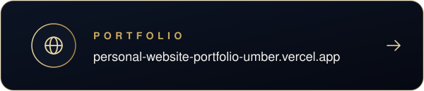</a>
  

